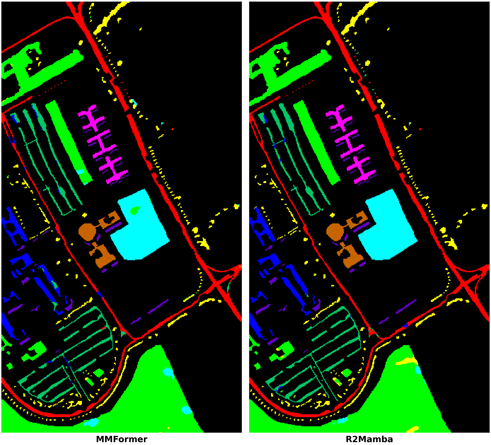
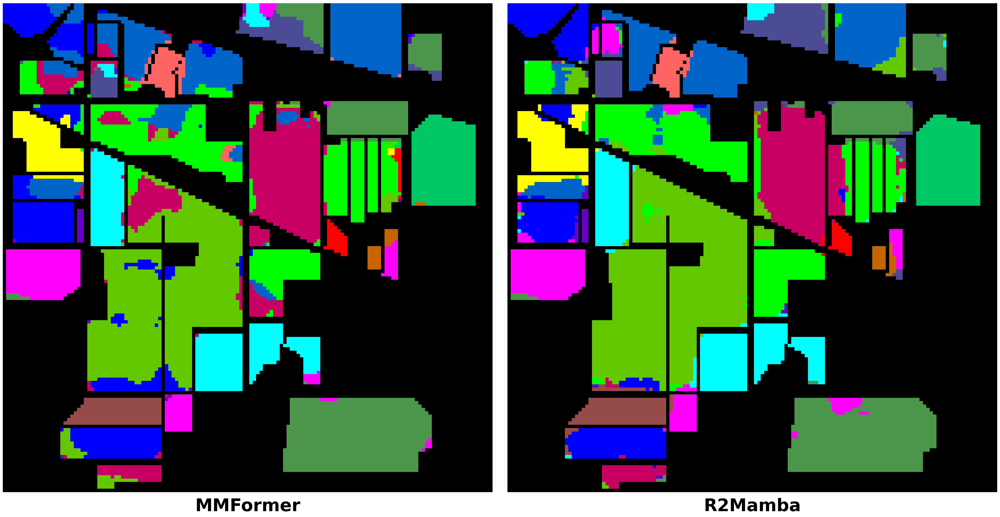

# 🛰️ Hyperspectral Image Classification: MMFormer vs. R2Mamba (2026)

> **Minor Project** — Department of Information Technology  
> A comparative study evaluating state-of-the-art **2026 Vision Transformer** vs. **2026 State Space Mamba** architectures for remote sensing hyperspectral classification.

---

## 👥 Project Team

| Name | Roll No. | GitHub |
|---|:---:|---|
| **Prince Prajapati** | 24124085 | [@lPrincel](https://github.com/lPrincel) |
| **Ayush Bansal** | 24124025 | |
| **Abhay Kaushal** | 24124003 | |

**Academic Guide:** Dr. Nitika Nigam, Department of Information Technology

---

## 📌 Project Overview

Hyperspectral Imaging (HSI) captures continuous spectral reflectance across dozens to hundreds of narrow bands, enabling material and crop identification. While earlier methods relied on 3D-CNNs and classical Transformers, recent 2026 breakthroughs introduce **Macro-Micro attention** and **Route-Reliability State Space Models (SSMs)**.

This project delivers a rigorous head-to-head empirical evaluation of the two latest 2026 models:
- **`MMFormer`** (*IEEE TGRS 2026*): Macro-Micro Vision Transformer with cross-scale feature fusion.
- **`R2Mamba`** (*IEEE JSTARS 2026*): Route-Reliability Mamba with linear-complexity $O(N)$ selective scanning.

Evaluated on two standard benchmark scenes (**Indian Pines** and **Pavia University**) across **3 independent seeded runs** (Seeds 1, 2, 3) to guarantee statistical reproducibility.

---

## 📊 Key Results (Mean ± Standard Deviation)

### 1. Overall Performance Summary

| Dataset | Metric | MMFormer (2026 Transformer) | R2Mamba (2026 Mamba / SSM) | Performance Gain |
|---|---|:---:|:---:|:---:|
| **Indian Pines**<br>*(AVIRIS, 16 Classes)* | **OA (%)**<br>**AA (%)**<br>**Kappa ($\times 100$)**<br>*Avg. Train Time* | $76.41 \pm 3.84$<br>$87.10 \pm 1.96$<br>$73.41 \pm 4.28$<br>~75s / run | **$\mathbf{83.89 \pm 1.66}$**<br>**$\mathbf{91.29 \pm 1.09}$**<br>**$\mathbf{81.71 \pm 1.87}$**<br>**~26s / run** | **+7.48% OA**<br>+4.19% AA<br>+8.30 Kappa<br>*(~3x faster)* |
| **Pavia University**<br>*(ROSIS, 9 Classes)* | **OA (%)**<br>**AA (%)**<br>**Kappa ($\times 100$)**<br>*Avg. Train Time* | $92.45 \pm 5.98$<br>$95.90 \pm 1.80$<br>$90.44 \pm 7.36$<br>~140s / run | **$\mathbf{97.59 \pm 0.60}$**<br>**$\mathbf{97.95 \pm 0.53}$**<br>**$\mathbf{96.86 \pm 0.77}$**<br>**~40s / run** | **+5.14% OA**<br>+2.05% AA<br>+6.42 Kappa<br>*(~3.5x faster)* |

### 2. Best Run Comparison (Peak Test OA)

| Dataset | MMFormer (Peak OA) | R2Mamba (Peak OA) |
|---|:---:|:---:|
| **Indian Pines** | 80.81% | **85.66%** |
| **Pavia University** | 96.80% | **98.03%** |

> 💡 **Core Finding:** `R2Mamba` consistently outperforms `MMFormer` in classification accuracy (up to +7.48% higher OA) while executing **3x to 3.5x faster** with dramatically lower variance ($\pm 0.60\%$ vs $\pm 5.98\%$), proving the stability and scalability of selective State Space Models over quadratic self-attention.

---

## 🗺️ Classification Maps

### Pavia University


### Indian Pines


---

## 🗂️ Repository Structure

```text
HSI-Classification-Minor-Project/
│
├── README.md                          # Comprehensive documentation & results
├── config/
│   ├── test_light.yaml                # Phase 1 lightweight baseline configuration
│   └── project_main.yaml              # Phase 2 main 2026 models benchmark configuration
│
├── notebooks/
│   ├── 01_pipeline_test/
│   │   └── HSI_Test_Run.ipynb         # Phase 1: Pipeline validation (HybridSN, SSRN, etc.)
│   └── 02_main_experiments/
│       └── HSI_Main_Project.ipynb     # Phase 2: Main MMFormer vs R2Mamba benchmark
│
├── results/
│   ├── classification_maps/           # Generated classification maps (.png)
│   ├── tables/                        # Detailed run-by-run metrics (.csv)
│   │   └── phase1_validation/         # Phase 1 baseline summaries
│   └── latex_tables/                  # Paper-ready LaTeX tables (.tex)
│
├── report/                            # Project report & documentation
│   └── .gitkeep
└── presentation/                      # PowerPoint presentation slides
    └── .gitkeep
```

---

## 🔬 Experimental Protocol

- **Dimensionality Reduction:** Principal Component Analysis (PCA) to 30 bands
- **Spatial Patch Size:** $11 \times 11$
- **Train / Val Sample Budget:**
  - *Indian Pines:* 10 train / 5 validation pixels per class (remaining for test)
  - *Pavia University:* 30 train / 10 validation pixels per class (remaining for test)
- **Repeats:** 3 independent seeded runs (`seeds: [1, 2, 3]`)
- **Optimization:** Adam ($\text{lr} = 0.001$, batch size = 64, early stopping patience = 12, max epochs = 80)
- **Evaluation Hardware:** NVIDIA Tesla T4 GPU

---

## 🚀 How to Reproduce

### Option A: Open in Kaggle
Upload `notebooks/02_main_experiments/HSI_Main_Project.ipynb` into a new Kaggle notebook with **GPU T4** accelerator and run all cells sequentially.

### Option B: Local / Cloud Terminal Setup
```bash
# 1. Clone repository
git clone https://github.com/lPrincel/HSI-Classification-Minor-Project.git
cd HSI-Classification-Minor-Project

# 2. Install requirements
pip install torch torchvision --index-url https://download.pytorch.org/whl/cu121
pip install "causal-conv1d>=1.4.0" --no-build-isolation
pip install "mamba-ssm>=2.2.2" --no-build-isolation
pip install tabulate pandas scipy scikit-learn matplotlib tqdm huggingface_hub

# 3. Run benchmark
python main.py config/project_main.yaml
python main.py config/project_main.yaml --arrange-scores
python main.py config/project_main.yaml --arrange-only
```

---

## 📚 References & Papers

1. **MMFormer (2026):** Tingrui Feng et al., *"Macro-Micro Transformer for Hyperspectral Image Classification"*, IEEE Transactions on Geoscience and Remote Sensing (TGRS), 2026. [DOI: 10.1109/TGRS.2026.3696892](https://doi.org/10.1109/TGRS.2026.3696892)
2. **R2Mamba (2026):** Xun Shang et al., *"Route-Reliability Mamba for Hyperspectral Image Classification"*, IEEE Journal of Selected Topics in Applied Earth Observations and Remote Sensing (JSTARS), 2026. [DOI: 10.1109/JSTARS.2026.3728152](https://doi.org/10.1109/JSTARS.2026.3728152)
3. **Framework Reference:** Tanishq Rachamalla et al., *"A PyTorch Library for Hyperspectral Image Models: Technical Report"*, arXiv:2609.39871, 2026.
4. **Benchmark Datasets:** NASA JPL/AVIRIS (Indian Pines) and DLR/ROSIS (Pavia University).

